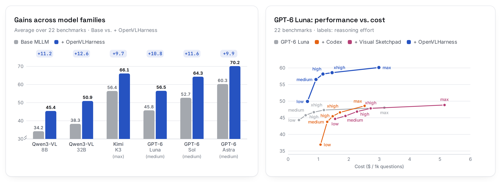

<h1 align="center">
  <picture>
    <source media="(prefers-color-scheme: dark)" srcset="assets/logo-dark.svg">
    
  </picture>
  OpenVLHarness
</h1>

<h3 align="center">Real-World Visual Agentic Tool&#8209;Use with Multimodal Memory</h3>

<p align="center">
  <a href="https://openvlharness.github.io/"></a>
  <a href="https://openvlharness.github.io/#playground"></a>
  <a href="https://huggingface.co/datasets/uclanlp/OpenVLHarness-Evaluation-Datasets"></a>
  <a href="LICENSE"></a>
  
</p>

<p align="center">
  <a href="https://openvlharness.github.io/">
    <picture>
      <source media="(prefers-color-scheme: dark)" srcset="assets/teaser-dark.png">
      
    </picture>
  </a>
</p>

<p align="center"><em>
OpenVLHarness is a training-free harness that lets multimodal models combine
perception, web search and Python computation, and keeps every piece of tool
evidence readable and reusable across reasoning steps.
</em></p>

<a id="highlights"></a>
## ✨ Highlights

- **Training-free.** Works with the backbone's existing weights through native
  tool calling; nothing is fine-tuned.
- **Nine capabilities.** Visual grounding, OCR, depth, camera trajectory, zoom,
  text search, image search, webpage visits and a Python coding agent, each behind a
  task-level interface that returns evidence the model can read.
- **Multimodal memory.** Images, boxes, masks, depth maps and web references stay
  addressable for the whole question, so later tools and code can build on them.
- **Consistent gains.** Across 22 benchmarks in four domains, seven backbones gain
  **9.7 to 12.6 points** on average over the same models without tools.
- **Any registered model.** Presets for six of the paper's seven backbones, plus
  every Qwen3-VL Instruct size and OpenAI's GPT-5 to GPT-6.1 models in the
  [model registry](docs/models.md#other-registered-models).

<a id="table-of-contents"></a>
## 🗂️ Table of Contents

- [How it works](#how-it-works)
- [Results](#results)
- [Installation](#installation)
- [Quick start](#quick-start)
- [Evaluation](#evaluation)
- [Configure and extend](#configure-and-extend)
- [Repository layout](#repository-layout)
- [Documentation and tests](#documentation-and-tests)
- [Acknowledgements](#acknowledgements)
- [License](#license)
- [Citation](#citation)

<a id="how-it-works"></a>
## 🔍 How it works

The model chooses tools, inspects their evidence, and continues until it can answer.
Three components let it combine evidence across steps:

- **Capability layer:** nine task-level interfaces turn tool outputs into readable
  observations, including annotated images, summaries, and compact numerical data.
- **Multimodal memory:** images, structured data, and web references remain
  addressable throughout a question. Each new question starts with fresh memory.
- **Python Coding Agent:** the backbone writes code in a separate context to
  calculate over stored boxes, masks, depth maps, and other tool results.

For example, an agent can locate objects, estimate depth, and compute their spatial
relationship; or crop an unfamiliar object, search for visual matches, and verify
the answer on a webpage.

| Capability | What it provides | Default backend |
| --- | --- | --- |
| Visual Grounding | Locate objects by text; return boxes, masks, and an annotated image | SAM 3 |
| OCR | Read text in an image | PaddleOCR-VL |
| Depth Estimation | Estimate per-pixel depth; retain the numerical array and visualization | Depth Anything 3 |
| Camera Trajectory | Estimate camera poses across ordered images | Depth Anything 3 |
| Zoom-in | Crop a region for closer inspection | Built-in image processing |
| Text Search | Retrieve and summarize web, image, news, and other search results | Serper + Qwen |
| Image Search | Find visual matches with reverse image search | Serper Lens + Qwen |
| Webpage Visit | Extract evidence relevant to a goal from webpages | Serper scrape + Qwen |
| Python Coding Agent | Generate and execute computations over stored tool results | Orchestrator backbone + local Python |

Every preset uses **Qwen3-VL-8B-Instruct for multimodal search summarization and
webpage extraction**, independently of the main model. The coding agent uses the
same backbone as the main model.

<a id="results"></a>
## 📈 Results

Average score over the paper's 22 benchmarks (counting and grounding, multimodal
search, general VQA and hallucination, and spatial understanding):

| Backbone | Base | + OpenVLHarness | Gain |
| --- | ---: | ---: | ---: |
| Qwen3-VL-8B-Instruct | 34.24 | **45.41** | +11.17 |
| Qwen3-VL-32B-Instruct | 38.30 | **50.92** | +12.62 |
| Kimi K3 (max effort) | 56.43 | **66.09** | +9.66 |
| GPT-5 (medium effort) | 44.37 | **55.65** | +11.28 |
| GPT-6 Luna (medium effort) | 45.76 | **56.52** | +10.76 |
| GPT-6 Sol (medium effort) | 52.67 | **64.31** | +11.64 |
| GPT-6 Astra (medium effort) | 60.27 | **70.17** | +9.90 |

Qwen3-VL results are the mean of three runs. Per-benchmark results, comparisons
with other harnesses, and recorded trajectories are on the
[project page](https://openvlharness.github.io/#results).

<a id="installation"></a>
## 🛠️ Installation

Use Python **3.10 or newer**. From a source checkout:

```bash
git clone https://github.com/uclanlp/OpenVLHarness.git
cd OpenVLHarness
python -m venv .venv
source .venv/bin/activate
python -m pip install -e '.[qwen,server]'
```

This installs the agent, Qwen tokenizer support, and the tool router. The model
servers have separate environments and dependencies. For a client connecting to
an existing router, `pip install -e .` is sufficient; add the `qwen` extra when
using Qwen for local context counting or raw trace export. Add the `eval` extra to
run benchmarks (see [Evaluation](#evaluation)).

<a id="quick-start"></a>
## 🚀 Quick start

### 1. Pick a preset

The release includes agent presets for six of the paper's seven backbones:

| Main model | Configuration | API |
| --- | --- | --- |
| Qwen3-VL-8B-Instruct | [qwen3_8b_paper.yaml](configs/agent/qwen3_8b_paper.yaml) | Chat Completions |
| Qwen3-VL-32B-Instruct | [qwen3_32b_paper.yaml](configs/agent/qwen3_32b_paper.yaml) | Chat Completions |
| GPT-5 | [gpt5_paper.yaml](configs/agent/gpt5_paper.yaml) | Responses |
| GPT-6 Luna | [gpt6_luna_paper.yaml](configs/agent/gpt6_luna_paper.yaml) | Responses |
| GPT-6 Sol | [gpt6_sol_paper.yaml](configs/agent/gpt6_sol_paper.yaml) | Responses |
| Kimi K3 | [kimi_k3_paper.yaml](configs/agent/kimi_k3_paper.yaml) | Chat Completions |

The paper's Qwen2.5-VL-7B-Instruct results, compared with training-based harnesses
in its appendix, used a separate configuration that this release does not include.

The registry also covers every Qwen3-VL Instruct size (2B to 235B-A22B, with FP8
builds) and OpenAI's GPT-5 to GPT-6.1 models; to use one, copy its family's
preset and change one line ([other registered models](docs/models.md#other-registered-models)).

### 2. Prepare models and tools

To run all nine capabilities, prepare these services before starting the agent:

- **Models:** serve Qwen locally or connect to a GPT or Kimi endpoint, following
  the [model setup guide](docs/models.md). Every preset also needs a
  Qwen3-VL-8B-Instruct endpoint for search tools; the 8B preset can share it with
  the main model, while the 32B preset needs a second server for it. Sharing one
  server is the simplest deployment and scores within run-to-run noise of the
  paper setup; its cost is throughput, since search summarization and webpage
  extraction queue behind agent turns on the same GPU. To reproduce the paper
  exactly, or to keep agent throughput at higher concurrency, serve a second
  Qwen3-VL-8B instance and point `AUXILIARY_MODEL_BASE_URL` at it. The guide
  includes the tested model revision, serving versions, and GPU configuration.
- **Perception:** launch SAM 3, PaddleOCR-VL, and Depth Anything 3 using the
  [tool service guide](openvlharness/services/tools/README.md). These run as
  separate GPU services behind the router.
- **Search:** the three search tools call [Serper](https://serper.dev), a paid
  Google Search API with a free starter quota: web/image/news search, Google
  Lens reverse image search, and page scraping for webpage visits. Configure
  its key using `SERPER_API_KEY` or `SERPER_API_KEY_FILE`. Reverse image search
  additionally needs a URL Serper can fetch for the query image: either the
  built-in image host behind a tunnel (no cloud account) or an
  [Amazon S3](https://aws.amazon.com/s3/) or
  [Google Cloud Storage](https://cloud.google.com/storage) bucket, where the
  image is uploaded and handed to Serper as a signed URL. Follow the
  [search and storage setup](openvlharness/services/tools/serper_text_search/README.md).

For the local Qwen setup, set these variables in both the router and agent
terminals. Adjust the addresses to match your deployment:

```bash
export MODEL_BASE_URL=http://127.0.0.1:8222/v1
export MODEL_API_KEY=empty
export AUXILIARY_MODEL_BASE_URL=http://127.0.0.1:8222/v1
export AUXILIARY_MODEL_API_KEY=empty
export JUDGE_MODEL=Qwen/Qwen3-VL-8B-Instruct
export JUDGE_API_BASE=http://127.0.0.1:8222/v1/chat/completions
export JUDGE_API_KEY=empty
export TOOL_SERVER_URL=http://127.0.0.1:8101
export SAM3_SERVER_URL=http://127.0.0.1:8086
export OCR_SERVER_URL=http://127.0.0.1:8085
export DEPTH_ESTIMATION_SERVER_URL=http://127.0.0.1:8087
```

The `empty` keys above are for unauthenticated local endpoints. For GPT or Kimi,
select its preset in the commands and Python example below, set `MODEL_BASE_URL`
and `MODEL_API_KEY` for that provider, and keep the auxiliary connection pointing
to Qwen. See the [connection examples](docs/models.md#connect-the-presets).

### 3. Run a question

Start the router with the same configuration that the agent will use:

```bash
python -m openvlharness.services.server --config configs/agent/qwen3_8b_paper.yaml
```

In another terminal with the environment configured, check the router:

```bash
curl --fail http://127.0.0.1:8101/health
curl --fail http://127.0.0.1:8101/backend-status
```

These checks only show that the router is up, how many tools it registered, and its
concurrency limits. Unreachable GPU workers, missing Serper keys and missing image
hosting settings surface on the first call to the affected tool. `/backend-status`
also reports `degradations`: counts of search and webpage-visit calls that fell
back to raw provider content because the auxiliary model timed out or returned
unusable output, and image searches whose published query image could not be fetched
at its public URL (`image_host`), and Serper calls rejected because of the account
(`serper_account`: credits exhausted, key invalid or payment required). A healthy router
keeps these at zero; the same events are logged with the tokens `SUMMARIZE_DEGRADED`,
`EXTRACT_DEGRADED`, `IMAGE_HOST_UNREACHABLE` and `SERPER ACCOUNT-LEVEL FAILURE`.

Then ask a question from Python:

```python
from openvlharness.bootstrap import build_agent

agent = build_agent("configs/agent/qwen3_8b_paper.yaml")
result = agent.generate([
    {"type": "image", "value": "/path/to/image.jpg"},
    {"type": "text", "value": "How many bottles are visible?"},
])
print(result["prediction"])
trajectory = result["extra_records"]["trajectory"]
```

Replace the image path with your own image. Inputs can include multiple images;
image values can be local paths, HTTP(S) URLs, or data URLs. The returned trajectory
records the model's turns, tool calls, and evidence for inspection.

If `result["prediction"]` is `Error: Unable to get response from the server.`, the
agent produced no answer. When a model request failed, the cause is in
`result["extra_records"]["trajectory"]["error"]`; without that key, the model ended
without a final answer. `Error: Reached the iteration limit without a final answer.`
means the question used all `agent.max_iterations` iterations; the trajectory's `error`
records the limit.

> [!WARNING]
> The coding tool runs generated Python in a subprocess on the agent host, with your
> user's permissions and with network and filesystem access. Its execution timeout
> is not a sandbox; run the agent in an isolated environment appropriate for your
> data. See [SECURITY.md](SECURITY.md) and the
> [coding tool README](openvlharness/services/tools/python_coding_agent/README.md).

<a id="evaluation"></a>
## 📊 Evaluation

### Run a small evaluation

Install the evaluation layer (benchmark loaders, judges and the runner) with the
`eval` extra, keeping the model and tool services running:

```bash
python -m pip install -e '.[eval,qwen]'
```

This installs the dependencies of the `openvlharness-eval` command;
`python run_benchmark.py` at the repository root is the same program. The
evaluation code lives in [evaluation_kit](evaluation_kit) and needs no GPU packages.

Use the same connection variables as above. `LMUData` is required: benchmark data
downloads there, and the evaluator raises an error if it is unset. Put it and the
work directory on a fast local disk. This example evaluates 12 reproducibly
sampled questions **per dataset** from the FSC147 and ODinW validation splits,
using direct counting and box metrics without an LLM judge:

```bash
export LMUData=/path/to/local/datasets
openvlharness-eval \
  --config configs/agent/qwen3_8b_paper.yaml \
  --judge-config configs/judge_no_judge.yaml \
  --data FSC147_val ODinW13_bbox_val_qwen3 \
  --num-examples 12 --shuffle --seed 42 \
  --num-proc 1 --save-html all --work-dir /path/to/local/runs
```

`--num-proc` controls concurrent examples. Remove `--num-examples` and `--shuffle`
to evaluate the full selected splits. For paper comparisons, also match the
benchmark prompts, judge settings, and scoring protocol in Appendix D. The paper
reports Qwen3-VL results averaged over three runs; a small subset checks the
installation rather than reproducing those scores.

### Datasets and scoring

Dataset names passed to `--data` select loaders in
[evaluation_kit/dataset](evaluation_kit/dataset). The paper's 22 benchmarks
(Table 1), the five additional search benchmarks of its appendix, and PixmoCount
(supported but not reported in the paper) are:

| Domain | Dataset names |
| --- | --- |
| Counting and grounding | `FSC147_val`, `CountQA`, `FSCD_147_bbox_val`, `FSCD_LVIS_bbox_val`, `ODinW13_bbox_val_qwen3` |
| Multimodal search and deep research | `MMSearch`, `MMSearchPlus`, `RealXBench`, `FVQA_test`, `hle`, `BrowseCompVL` |
| General VQA and hallucination | `RealWorldQA`, `SimpleVQA`, `HallusionBench`, `FREAK_VQA`, `FREAK_MCQ`, `VStarBench` |
| Spatial understanding | `MMSIBench_wo_circular`, `ERQA`, `EmbSpatialBench`, `SparBench_tiny`, `MindCubeBench_tiny_raw_qa` |
| Extended search (appendix) | `MMBrowseComp`, `VDRBench`, `VisBrowseBench`, `Infoseek_GDM_test`, `EncyclopedicVQA_test` |
| Additional | `PixmoCount_val` |

Every dataset above except `PixmoCount_val` and `CountQA` downloads, with its images,
from [OpenVLHarness-Evaluation-Datasets](https://huggingface.co/datasets/uclanlp/OpenVLHarness-Evaluation-Datasets)
into `LMUData` on first use; the loaders build those two from their original
sources. `PixmoCount_val` is built from
[allenai/pixmo-count](https://huggingface.co/datasets/allenai/pixmo-count), with
images fetched from their original URLs; images that can no longer be fetched are
left out, so a fresh build can contain fewer than the 534 images the paper evaluated.
`CountQA` is built from
[Jayant-Sravan/CountQA](https://huggingface.co/datasets/Jayant-Sravan/CountQA) on
the Hugging Face Hub. ODinW also downloads evaluation annotations into `LMUData/GLIP`
unless `GLIP_ROOT` is set. The
[preparation scripts](evaluation_kit/dataset/scripts) document how the released
splits were built.

`FVQA_test`, `Infoseek_GDM_test` and `EncyclopedicVQA_test` are the largest search
benchmarks (1,800, 2,000 and 1,960 questions). `FVQA_test_300`,
`Infoseek_GDM_test_300` and `EncyclopedicVQA_test_300` are fixed 300-question subsets
of them, a quick estimate of the full-split score at a fraction of the time and
search cost; `SimpleVQA_300` is the 300 English SimpleVQA questions WebWatcher
evaluates on.

Benchmarks that need an LLM judge or answer extractor read it from `JUDGE_MODEL`,
`JUDGE_API_BASE` (the full chat-completions URL) and `JUDGE_API_KEY` through
[configs/judge.yaml](configs/judge.yaml); any OpenAI-compatible endpoint works. The
paper judged with Qwen3-VL-8B-Instruct, and with GPT-4o on the search and
deep-research benchmarks:

```bash
export JUDGE_MODEL=gpt-4o
export JUDGE_API_BASE=https://api.openai.com/v1/chat/completions
export JUDGE_API_KEY=$OPENAI_API_KEY
```

One judge serves every dataset of an invocation, so evaluate the search benchmarks in a
separate `openvlharness-eval` run from the others, or re-score a finished run with
`--mode eval --run-dir <run> --judge-config configs/judge.yaml` after switching the variables.

<details>
<summary>Grounding confidence scores</summary>

[configs/judge_no_judge.yaml](configs/judge_no_judge.yaml) selects
`score_mode: constant`, assigning every predicted box a confidence of 1.0.
For ODinW, FSCD, and LVIS grounding, set `score_mode: original` to use matching
tool detection scores. The configured value takes precedence over `SCORE_MODE`.
With neither override, evaluators run both modes when detection sidecars exist
(original is primary), or constant alone otherwise. The primary mode owns the
unsuffixed metrics files; alternate metrics include the mode in their filenames.

</details>

### Inspect and resume runs

Results are saved under `<work-dir>/<model>/<agent>/<run_id>/<dataset>/`.
For image/text benchmarks, the main artifacts are:

| Artifact | Contents |
| --- | --- |
| `<model>.xlsx` | Predictions; set `PRED_FORMAT=tsv` or `PRED_FORMAT=json` to change the format |
| Dataset-specific metric files | Scores and diagnostics written by the evaluator |
| `full_trajectories/<sample_id>.json` | Agent messages, tool results and final answer |
| `full_trajectories/images/` | Copied trajectory images; `--save-images base64` embeds images instead |
| `tool_detections/<sample_id>.json` | Detection sidecars for samples with grounding results |
| `htmls/<sample_id>.html` | Browsable tool evidence when `--save-html all` is supplied |
| `<model>_incremental.jsonl` | Streaming results when `--incremental-json` is supplied |

Prediction filenames use the model ID's final component, such as
`Qwen3-VL-8B-Instruct`.

The parent run directory contains `run_manifest.json`,
`agent_config.redacted.yaml`, `judge_config.redacted.yaml`, and
`tool_env_snapshot.json`, recording the effective configuration, resolved model
profiles and service metadata. Add `--resume` to continue a compatible partial
run; changes to the effective configuration require a new run. Rows that failed
because a service was unreachable are scored as incorrect; once the service is
back, rerun with `--run-dir <run-dir> --ignore-failed` to redo only those rows.

To evaluate saved predictions, select the run directly:

```bash
openvlharness-eval --mode eval --run-dir "$RUN_DIR" --data FSC147_val
```

Evaluation reads the saved model identity, prediction format and judge configuration;
it does not load the inference agent, tokenizer or tool connections. Supply
`--judge-config` when changing the judge or replacing redacted judge credentials.
Inference resumes still validate the effective configuration and resolved model
profiles. Without `--run-dir`, evaluation discovers the latest complete saved run
under `--work-dir`; use `--run-dir` when several model/agent identities are present.

For **Qwen3-VL-8B-only token-level export**, add `--save-raw-trace`. This writes per-sample
JSON and images under `raw_traces/`, with explicit error records for export
failures. It requires a matching tokenizer and a server that returns token IDs;
see [raw trace export](docs/models.md#raw-trace-export-qwen-only). Ordinary
trajectory JSON and HTML reports work with every preset.

Where files go:

- Run outputs go under `--work-dir` (default `./outputs`).
- Benchmark TSVs and images go in `$LMUData`.
- Image archives and ODinW annotations are downloaded into the Hugging Face cache
  (`HF_HOME`, default `~/.cache/huggingface`) and then extracted into `$LMUData`,
  so they are stored twice: about 3.6 GB of archives for the datasets listed above.
  The CountQA and PixmoCount sources are cached there as well.
- ODinW annotations go in `$LMUData/GLIP` unless `GLIP_ROOT` is set.
- `openvlharness-eval` reads `./.env` if present, without overriding variables that
  are already set. The router and the Python API do not read it.
- For inference, the default `--config` and `--judge-config` paths
  (`configs/agent/qwen3_8b_paper.yaml` and `configs/judge.yaml`) are relative, so
  run from the repository root or pass both.

<a id="configure-and-extend"></a>
## 🧩 Configure and extend

Each agent YAML separates `agent` policy, `memory`, `capabilities`, and `services`.
Start from a copy of a paper preset and select the capabilities your deployment
can support.

### Choose tools for your available infrastructure

| Keys under `capabilities.tools` | Requirements in the paper setup |
| --- | --- |
| `grounding` | A SAM 3 GPU worker |
| `ocr` | A PaddleOCR-VL GPU worker |
| `depth`, `camera_pose` | A shared Depth Anything 3 GPU worker |
| `text_search`, `web_visit` | A funded **Serper** API key and the auxiliary Qwen model endpoint |
| `image_search` | Serper and auxiliary Qwen, plus a public URL for the query image: the built-in image host behind a tunnel, or an **Amazon S3 or Google Cloud Storage bucket** with upload/signing credentials |
| `zoom` | CPU image processing in the router; no external API or GPU worker |
| `coding` | The orchestrator model endpoint for code generation and local CPU Python execution |

GPU workers can run on another machine reachable from the router. The main Qwen
model and the auxiliary Qwen summarizer also need model serving, separately from
these perception workers; a hosted main model still needs auxiliary Qwen when
the search capabilities are enabled. See the [model](docs/models.md) and
[tool deployment](openvlharness/services/tools/README.md) guides.

Only reverse image search needs image hosting. Text search, including its
image-search mode, and webpage visits do not. Configure `SERPER_API_KEY` or
`SERPER_API_KEY_FILE` in the router environment, and follow the
[S3/GCS credential instructions](openvlharness/services/tools/serper_text_search/README.md#credentials-and-reverse-image-upload)
when enabling `image_search`.

### Disable capabilities you do not need

1. Remove the corresponding keys from `capabilities.tools`. For example, remove
   `image_search` to avoid the image-hosting requirement; remove `text_search`,
   `image_search`, and `web_visit` to disable Serper-backed tools altogether.
   Remove `grounding`, `ocr`, `depth`, and `camera_pose` to omit the GPU perception
   workers. Both depth and camera capabilities must be removed to stop needing DA3.
2. Delete the now-unused entries from `services.tools`. If all search capabilities
   are removed and nothing else uses it, also delete `services.models.auxiliary`.
   **Every `${VARIABLE}` remaining in the YAML is expanded during loading**, and
   every configured model is validated, even if its capability is disabled.
   Removing unused connections lets you leave their environment variables unset.
3. Restart the router with the edited file and pass that same file to
   `build_agent(...)` or `openvlharness-eval --config ...`. Check `/tools` and
   `/llm-schema` to confirm the selected tool set. Disabled capabilities are omitted
   from the model's tool schemas and their backend implementations are not loaded.

<details>
<summary>Example: zoom and coding with a hosted GPT model, without GPU tool workers, Serper, or cloud storage</summary>

This configuration ships as [examples/local_tools.yaml](examples/local_tools.yaml).
It needs only `MODEL_BASE_URL`, `MODEL_API_KEY`, and `TOOL_SERVER_URL` from the
quick start; point the model connection to your GPT Responses endpoint. Code
generation still calls that model endpoint.

```yaml
agent_name: MainAgent
agent_config_version: local_tools_v1
agent:
  model_service: orchestrator
  max_iterations: 15
memory:
  modules: [{name: image}, {name: tool_context}, {name: url}]
  emit_policy: always
capabilities:
  registries: [paper]
  tools:
    zoom:
      backend: zoom_in_image_by_bbox
    coding:
      generator: python_coding_agent
      executor: python_executor_local
services:
  client:
    base_url: ${TOOL_SERVER_URL}
  server:
    host: 127.0.0.1
    port: 8101
    registration: configured_only
  tools:
    zoom_in_image_by_bbox: {}
    python_coding_agent:
      model_service: orchestrator
      context: fresh
    python_executor_local:
      transport: local
      timeout_seconds: 30
  models:
    orchestrator:
      alias: gpt-6-luna
      base: ${MODEL_BASE_URL}
      key: ${MODEL_API_KEY}
      max_tokens: 16000
      reasoning_effort: medium
```

Start it with
`python -m openvlharness.services.server --config examples/local_tools.yaml`,
then use `build_agent("examples/local_tools.yaml")`. Keep the configured
router port aligned with `TOOL_SERVER_URL`.

</details>

### Use another model

Registered models are listed in the [model guide](docs/models.md#other-registered-models):
copy the preset of the same family and change the orchestrator's `alias`. To add a
model outside those families, register its served ID, API protocol, prompt, and
supported options in [model_registry.yaml](openvlharness/services/model_registry.yaml).
Auxiliary models can also use a registered compatible profile; multimodal Qwen
remains the official search default.

### Connect your own service

For SAM 3, OCR, DA3, or GroundingDINO workers, point
`services.tools.<backend>.server_url` to a service implementing that backend's HTTP
contract. For example, merge this fragment into your configuration to use a SAM 3
worker on another host:

```yaml
services:
  tools:
    sam3_segment:
      server_url: http://gpu-host:8086
```

Use the service base URL; the backend wrapper adds the request route. The service
must accept the wrapper's request format and return the expected result fields.
The optional [GroundingDINO backend](openvlharness/services/tools/grounding_dino/README.md)
shows how to select a different implementation of the same grounding capability.

To integrate a service with a different API, add a wrapper under
`openvlharness/services/tools/<backend>/tool.py`; the
[OCR wrapper](openvlharness/services/tools/ocr/tool.py) is an HTTP example and
the [zoom backend](openvlharness/services/tools/zoom_in_image_by_bbox/tool.py)
is a small local example. Implement the backend's `BaseTool.execute` method,
translate its response to the capability's expected fields, and register the
backend as described below. Endpoints and credentials belong in deployment
configuration or the service environment; public tool arguments describe the task.

### Add a capability or backend

New capability names and backends require source registration before they can be
selected in YAML. The relevant files are:

1. **Capability interface:** create `openvlharness/capabilities/<name>.py`,
   following [zoom.py](openvlharness/capabilities/zoom.py). Define the public
   function schema, a typed output contract, and a `Capability` subclass of
   [BaseCapability](openvlharness/capabilities/_base.py). Set `name`, `schema`,
   and `backends` (backend key to concrete tool class name). Implement
   `normalize_result` and `process_output` for canonical results and model-readable
   evidence. Use `translate_args`, `validate_result`, and `store_result` as needed
   to adapt arguments, validate results before registration, and retain numerical
   data for later tools. Image arguments such as `image_id` resolve through memory.
2. **Backend implementation:** add a package with `__init__.py` and `tool.py` under
   `openvlharness/services/tools/<backend>/`. Its tool class must match the
   capability's `backends` mapping. Implement
   [BaseTool](openvlharness/services/tools/base.py)'s `execute` method and return
   result data; the router adds the success/error envelope and tool-call ID.
3. **Configuration registration:** update `PAPER_CAPABILITIES`, `PAPER_BACKENDS`,
   and the backend/service-option validation in
   [bootstrap.py](openvlharness/bootstrap.py). For another implementation of
   an existing capability, extend its `backends` mapping and accepted backend
   selections. Add HTTP workers to `RAW_BACKENDS` when they need `server_url`
   injected from their service configuration.
4. **Router wiring:** [server.py](openvlharness/services/server.py) imports the
   configured backend class. Extend its construction logic if your tool needs
   injected model clients or other dependencies. For resource-limited services,
   assign a `BACKEND_GROUPS` entry and a `DEFAULT_LIMITS` concurrency limit. Keep
   capability and backend registration available on both the agent and router hosts.
5. **Select and verify:** add `capabilities.tools.<name>.backend` and the matching
   `services.tools.<backend>` settings to your YAML. Add focused coverage in
   [tests/test_capabilities.py](tests/test_capabilities.py) and
   [tests/test_services.py](tests/test_services.py) for valid calls, malformed
   arguments/results, and any stored image or numerical artifacts. Run a small
   question and inspect its trajectory to verify the model can use the evidence.

See [runtime design](docs/runtime.md) for capability, memory, and service contracts.

<a id="repository-layout"></a>
## 📁 Repository layout

```text
openvlharness/          the harness (installed as the openvlharness package)
  agent/                orchestrator loop over model requests and tool calls
  capabilities/         the nine capability interfaces above
  memory/               per-question multimodal memory and Environment Update
  services/             model profiles, tool client and tool router
    tools/              tool backends (SAM 3, OCR, depth, search, Python executor, ...)
  prompts/              system prompts
  bootstrap.py          builds an agent from a YAML config
evaluation_kit/         benchmark loaders, judges and the runner (openvlharness-eval)
configs/                paper agent presets and judge settings
examples/               example agent configurations
docs/                   model, runtime and validation notes
tests/                  harness tests; tests/evaluation/ needs the eval extra
validation/             fixed perception subset for checking a tool deployment
assets/                 logo and README figures
run_benchmark.py        same program as openvlharness-eval
```

The harness never imports `evaluation_kit`; the evaluation layer uses the
harness the same way any other application would.

<a id="documentation-and-tests"></a>
## 📚 Documentation and tests

| Guide | Contents |
| --- | --- |
| [Model services](docs/models.md) | Presets, registered models, Qwen serving, GPT and Kimi connections, per-role settings, raw trace export |
| [Tool services](openvlharness/services/tools/README.md) | GPU workers, router deployment, search credentials, backend guides |
| [Runtime design](docs/runtime.md) | Agent loop, configuration, memory, capability interfaces |
| [Benchmarks and judges](evaluation_kit/dataset/README.md) | Benchmark loaders, metrics, judge configuration, `score_mode` |
| [Release validation](docs/validation.md) | Regression coverage and live validation evidence |
| [Security](SECURITY.md) | What runs where, what leaves your machine, reporting vulnerabilities |

To run the package tests:

```bash
python -m pip install -e '.[test,server]'
python -m pytest tests -q
```

The evaluator tests under `tests/evaluation` are collected only when the `eval`
extra is installed as well.

<a id="acknowledgements"></a>
## 🙏 Acknowledgements

The benchmark loaders and evaluators build on
[VLMEvalKit](https://github.com/open-compass/VLMEvalKit). The default tools use
[SAM 3](https://github.com/facebookresearch/sam3),
[Depth Anything 3](https://github.com/ByteDance-Seed/Depth-Anything-3),
[PaddleOCR-VL](https://github.com/PaddlePaddle/PaddleOCR) and the
[Serper](https://serper.dev/) search APIs, and
[Qwen3-VL](https://github.com/QwenLM/Qwen3-VL) serves as the default backbone and
search summarizer. We thank their authors for releasing them.

<a id="license"></a>
## 📄 License

OpenVLHarness is released under the [MIT License](LICENSE). The benchmark
loaders and evaluators under `evaluation_kit/` are derived from
[VLMEvalKit](https://github.com/open-compass/VLMEvalKit) (Apache License 2.0), and
the SAM 3 visualization helpers in `openvlharness/services/tools/sam3_segment/viz/`
are under the SAM License. See [THIRD_PARTY_LICENSES.md](THIRD_PARTY_LICENSES.md)
for these notices and for the licenses of the models, services and datasets the
default tools use, which are not covered by the MIT License.

<a id="citation"></a>
## 📝 Citation

If you use OpenVLHarness in your research, please cite:

```bibtex
@misc{openvlharness2026,
  title  = {OpenVLHarness: Real World Visual Agentic Tool-Use with Multimodal Memory},
  author = {Zhou, Yu and Yang, Cheng-Fu and Sun, Rui and Wu, Di and Peng, Sibo and Zhang, Mingyang and Yang, Zhen and Zhang, Ruiyi and Peng, Nanyun and Gan, Zhe and Chang, Kai-Wei},
  year   = {2026},
  url    = {https://openvlharness.github.io/}
}
```
