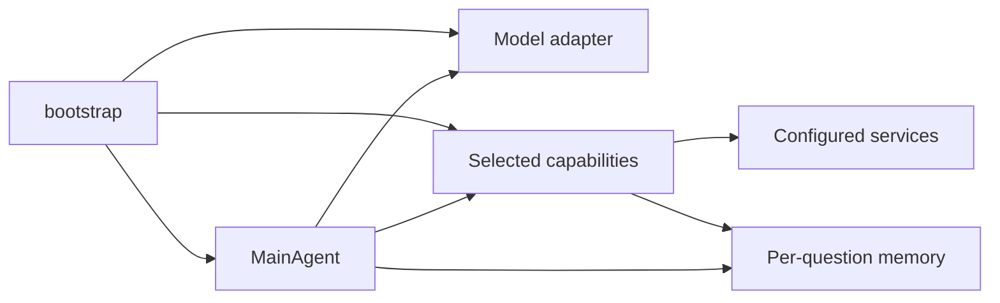

# Runtime contracts

`bootstrap.py` resolves one agent-system YAML, validates configuration and builds
one `MainAgent`, a model adapter, the selected flat capabilities and a memory
factory. There is no backend discovery during a question.

The agent owns turn ordering, one-call enforcement, stopping and reporting.
Capabilities own public input schemas, typed canonical output contracts, argument
translation, artifact registration and rendered evidence. Services execute work
without reading memory. Memory stores generic images, bindings and URL references;
it does not discover tools or interpret backend result fields.

Each call has a `VirtualCall` with the native call ID. Its `CapabilityResult`
contains success/error, canonical data, model-facing evidence and artifact refs.
Private trace fields preserve the concrete backend, raw envelope and grounding
sidecars. Canonical fields are always present: null means unavailable; an empty
list means a supported collection was evaluated and empty. Native arrays stay in
memory, with binding references in depth/camera canonical data.

## Memory and turn order

Agent configurations must include the `image` module in `memory.modules`.
Disabling persistent image memory is rejected at startup because vision tools
require registered image references; this release does not implement that ablation.

Each question begins with fresh memory. Input images receive `input_image_N`
handles; tool images receive `tool_generated_image_N`, numbered in registration
order. An identical data URL resolves to its existing handle, aliases resolve
case-insensitively, and remote image URLs receive a handle when registered and
are downloaded on first use.

A successful tool call registers images, typed bindings, then webpage references.
The capability renders evidence after registration. Chat Completions appends a
matching tool acknowledgement, user-role evidence and one coalesced Environment
Update. Responses appends a matching `function_call_output` containing the same
text/images, followed by the Environment Update. Failed payloads skip result
registration and do not emit a new inventory. A resolved lazy input image may
already exist before a later backend failure.

Depth arrays and camera matrices are stored as float32. SAM3 results are stored
as a `segment_<query>` binding that keeps the RLE masks. Local Python receives
copied actual values; the generation service receives only descriptors.
Generated variables are not persisted as new memory bindings. A local
`execution_error` is returned inside a successful coding result; it does not
fail the tool call.

Depth results validate base64 encoding, positive `[height, width]` dimensions,
the exact float32 byte count and finite values before registering any artifacts.
Malformed depth results fail explicitly and do not advertise a usable array or
leave partial bindings. Both `depth_shape` and `size` use `[height, width]` order.

The Environment Update lists images, data bindings and webpages in that order
after a fixed preamble. The default `always` policy may repeat unchanged
inventory after a successful call. `on_change` emits only when the image
sources, the webpage count or the binding count changed. The URL limit shows the
latest 20 entries without evicting older references.

## Native model behavior

Profiles explicitly select protocol, prompts, final-answer parsing and context
policy. Qwen uses the packaged `v8_instruct` prompt, Chat Completions and its own
tokenizer for the 168000-token context cap. If the tokenizer cannot load, a
warning records that the provider enforces context size. GPT profiles use
`openai_v1`, stateless Responses (`store=false`) and provider context
enforcement. Kimi K3 uses `openai_v1`, Chat Completions and provider context
enforcement.

The paper configurations use 15 iterations. When the iterations run out, Qwen
and Kimi K3 send an extra final-answer request; they also continue after an
empty answer and extract the answer from `<answer>` tags. GPT profiles fall back
to the assistant text when no tag is present and append the final message. Tool
schemas are sent sorted by public tool name. A turn with more than one tool call
executes none of them; each call returns an error asking for one call per turn.

Orchestrator and tool-router HTTP requests retry transient failures up to
`retry` additional times: 8 in the paper presets, so up to nine attempts, with
exponential backoff of at most 30 seconds between attempts. Their timeouts are
600 seconds (1800 seconds for the Kimi K3 orchestrator). Structured router errors retain
their call IDs and are returned once. Search uses the OpenAI SDK's separate
two-retry policy, with a five-second connection timeout and 600-second remaining
timeouts. Coding uses the orchestrator backbone and native protocol, a fresh
prompt, 4096 output tokens and a fixed 600-second request timeout. Its local
executor has a 30-second limit; generated Python is not sandboxed.

Retries apply to HTTP 408, 429, 500, 502, 503 and 504 and, when there is no HTTP
status, to request timeouts and connection errors. Other statuses, including 400
and 401, fail at once. Structured tool failure envelopes are not retried.

## Deployment and extension boundaries

Benchmark run manifests save the resolved profile for every configured model
service, including auxiliaries, and SHA256 hashes of its bundled system prompt
and the shared user prefix. The resume identity combines these with the agent
configuration, excluding credentials. Editing a referenced registry entry or
prompt content therefore rejects resume into the same run, even when the YAML
alias is unchanged. Unreferenced registry entries do not affect the identity.
A saved manifest whose identity hash differs is rejected; start a new run
directory rather than mixing new inference into those saved results.

The router acquires per-backend capacity before entering the thread pool. Depth
and camera share one capacity group; queued GPU work does not block health
requests. Gates are process-local: deploy one router worker per configured raw
backend budget, or coordinate limits outside the process when scaling workers.
Endpoints, credentials and tuning fields cannot be supplied as model task args.

The paper registry contains nine public tools. The only extension backend is
GroundingDINO under the grounding capability; no other backend is registered.
New backends belong behind the corresponding capability; new model profiles
explicitly declare their protocol and supported options.

OCR stores its transcription as `ocr_result["text"]`, including a valid empty
string, and advertises it to code generation. DINO stores `segment_<query>`
with `pred_boxes`/`pred_scores` and null masks and count. Its evidence describes
bounding boxes only.

The model-visible Text Search description states that the caller selects
`search_type` (general web search by default, or images, news, scholar, maps,
places, shopping or patents), that the retrieved evidence is summarized, and
that retained, reranked results are returned with source titles, snippets or
metadata and available links.

Reports retain partial trajectories when a transport exception ends a question
and record token usage: the numeric fields of every response's `usage` object
are summed into `usage.total`. These reporting fields do not alter model inputs.

Explicit Qwen raw trace export captures each native response with its own request
messages in per-question state. The final successful response is reconstructed in
the model export helper using the registered tokenizer, including reduced context,
provider-error fallback, or the extra final-answer request. Token decoding and
image alignment remain outside the agent loop. Raw export does not change the
ordinary trajectory history; optional `raw_trace` or `raw_trace_error` records
describe the export.
See [raw export setup and failure reporting](models.md#raw-trace-export-qwen-only).

Malformed grounding and webpage records are rejected before artifact
registration, and endpoint URLs with embedded credentials are rejected when the
configuration loads. Local coding executes in a disposable subprocess with
copied NumPy bindings. Child stdout is captured separately from agent threads,
with a 64-KiB retained output limit and bounded variable previews. The positive
finite deadline covers startup, execution and preview rendering; expiry forcibly
kills the worker and, on POSIX, its inherited process group. Blocking calls and
exception-catching loops cannot suppress this deadline. The executor does not
change the agent's stdout or signal handlers. Generated code has normal process
permissions.

## Configuration reference

`load_agent_config` in `openvlharness/bootstrap.py` accepts the keys below and
rejects unknown keys in each section it validates. It checks
`services.tools.<backend>` only for the selected backends, and
`python_executor_local` only when coding is enabled; other entries are ignored.
The router checks `services.server.limits` group names and values when it
starts. `${NAME}` placeholders anywhere in the file are replaced
from the environment when the file loads; a missing variable is an error.
"Required" keys have no default. The paper presets share every value except
where the table names a model.

| Key | Type | Default | Paper presets | Effect |
| --- | --- | --- | --- | --- |
| `agent_name` | string | required | `MainAgent` | Must be `MainAgent`. |
| `agent_config_version` | string | none | `paper_v1` | Prefix of the run ID (`agent_<version>_judge_<version>_<timestamp>_<tag>`). Required by `openvlharness-eval`. |
| `agent.model_service` | string | required | `orchestrator` | The `services.models` entry used as the orchestrator. |
| `agent.max_iterations` | positive integer | `15` | `15` | Maximum model/tool iterations per question; the last one asks for a final answer. |
| `agent.max_context_length` | positive integer or null | null | `168000`; Kimi K3 `256000` | Context budget including the reserved output tokens; must exceed the orchestrator's `max_tokens` plus 512. Qwen profiles count tokens locally and compact history to fit. Other profiles, or null, leave enforcement to the provider. |
| `agent.tool_choice` | string | `auto` | `auto` | Sent as the provider's `tool_choice` on regular requests. Not validated locally. |
| `agent.paired_sampling_seed` | boolean | `false` | `false` | When true, Chat Completions requests for a sample with a task ID carry a seed derived from that ID, the iteration index and `HARNESS_SEARCH_SAMPLE_INDEX`. Responses requests carry no seed. |
| `memory.modules` | list of `{name: ...}` mappings | required | `image`, `tool_context`, `url` | Enabled memory modules, unique and ordered `image`, `tool_context`, `url`. `image` is required. `tool_context` stores typed tool results (depth, camera, segmentation, OCR) as bindings for code execution; `url` stores webpage references for later tool calls. |
| `memory.modules[url].webpage_env_update_limit` | positive integer or null | `20` | `20` | Number of most recent webpage references listed in each Environment Update; null lists all. Older references stay resolvable. No other module accepts options. |
| `memory.emit_policy` | `always` or `on_change` | `always` | `always` | `always` emits the inventory after every successful tool turn; `on_change` emits only when images, the webpage count or the binding count changed. |
| `capabilities.registries` | list | required | `[paper]` | Must include `paper`. Adding `extensions` allows `grounding_dino` as the grounding backend. |
| `capabilities.tools` | mapping | required | all nine capabilities | Selected capabilities. `grounding`, `ocr`, `depth`, `camera_pose`, `zoom`, `text_search`, `image_search` and `web_visit` each take `{backend: <name>}`; `coding` takes `{generator: python_coding_agent, executor: python_executor_local}`. Omitted capabilities are disabled. |
| `services.client.base_url` | HTTP(S) URL | required | `${TOOL_SERVER_URL}` | Router base used by the agent, without an endpoint suffix. |
| `services.client.timeout_seconds` | positive number | `600` | `600` | Timeout of each agent-to-router request, in seconds. |
| `services.client.retry` | non-negative integer | `8` | `8` | Additional attempts after transient router failures. |
| `services.server.host` | string | `127.0.0.1` | `127.0.0.1` | Router listen address. |
| `services.server.port` | integer, 1-65535 | `8101` | `8101` | Router listen port. |
| `services.server.registration` | string | `configured_only` | `configured_only` | The only accepted value: the router loads only the selected backends. |
| `services.server.limits` | mapping of group to positive integer | `depth: 1`, `sam3: 1`, `dino: 2`, `ocr: 10`, `webpage: 8`, `search: 4`, `coding: 10` | not set | Concurrent requests per backend group within one router process. `depth` covers depth and camera pose; `search` covers text and image search. Other group names fail when the router starts. |
| `services.tools.<backend>.server_url` | HTTP(S) URL | required | `${SAM3_SERVER_URL}`, `${OCR_SERVER_URL}`, `${DEPTH_ESTIMATION_SERVER_URL}` | Raw server base for `sam3_segment`, `ocr`, `depth_estimation`, `camera_trajectory` and `grounding_dino`, without an endpoint suffix. Depth and camera pose share the DA3 server. |
| `services.tools.serper_*.model_service` | string | `auxiliary` | `auxiliary` | Model service for summarization and webpage extraction in `serper_text_search`, `serper_image_search` and `serper_webpage_visit`. |
| `services.tools.python_coding_agent.model_service` | string | `agent.model_service` | `orchestrator` | Model service for code generation; must resolve to the orchestrator's model and protocol. |
| `services.tools.python_coding_agent.context` | string | `fresh` | `fresh` | The only accepted value: code generation uses its own prompt, not the orchestrator conversation. |
| `services.tools.python_executor_local.transport` | string | `local` | `local` | The only accepted value. |
| `services.tools.python_executor_local.timeout_seconds` | positive number | `30` | `30` | Deadline for executing generated code, in seconds. |
| `services.tools.zoom_in_image_by_bbox` | empty mapping | required when zoom is selected | `{}` | Takes no options. |
| `services.models.<name>.alias` | string | required | Qwen `qwen3-vl-8b-instruct`, `qwen3-vl-32b-instruct`; GPT `gpt-5-2025-08-07`, `gpt-6-luna`, `gpt-6-sol`; `kimi-k3`; auxiliary `qwen3-vl-8b-instruct` | Registered profile: served model ID, protocol, prompt bundle and accepted options. |
| `services.models.<name>.base` | HTTP(S) URL | required | `${MODEL_BASE_URL}`, `${AUXILIARY_MODEL_BASE_URL}` | Service base, `/v1` base, or a full endpoint matching the profile's protocol. |
| `services.models.<name>.key` | string | empty | `${MODEL_API_KEY}`, `${AUXILIARY_MODEL_API_KEY}` | Bearer API key; `empty` or an empty value for unauthenticated endpoints. |
| `services.models.<name>.timeout` | positive number | `600` | `600`; Kimi K3 orchestrator `1800` | HTTP request timeout, in seconds. The coding generator always uses 600 seconds. |
| `services.models.<name>.retry` | non-negative integer | `8`; `2` for search and webpage calls | orchestrator `8`, auxiliary `2` | Additional attempts after transient failures. |
| `services.models.<name>.max_tokens` | positive integer | `4096` | Qwen `12800`, GPT `16000`, Kimi K3 `65536` | Output budget, also reserved from `agent.max_context_length`. |
| `services.models.<name>.temperature` | number, 0-2 | provider default | Qwen `0.7`, Kimi K3 `0.6` | Qwen and Kimi profiles. |
| `services.models.<name>.top_p` | number in (0, 1] | provider default | Qwen `0.8`, Kimi K3 `0.95` | Qwen and Kimi profiles. |
| `services.models.<name>.top_k` | positive integer | provider default | Qwen `20` | Qwen profiles. |
| `services.models.<name>.repetition_penalty` | number > 0 | provider default | Qwen `1.0` | Qwen profiles. |
| `services.models.<name>.presence_penalty` | number, -2 to 2 | provider default | Qwen `1.5` | Qwen profiles. |
| `services.models.<name>.reasoning_effort` | `none`, `minimal`, `low`, `medium`, `high`, `xhigh` or `max` | provider default | GPT `medium` | GPT and Kimi profiles; each model rejects the levels it does not support. |
| `services.models.<name>.return_token_ids` | boolean | `false` | Qwen `false` | Requests token IDs for raw trace export. `true` is accepted only for `qwen3-vl-8b-instruct`; `--save-raw-trace` sets it. Qwen profiles. |

Each selected backend needs a `services.tools.<backend>` mapping. The model
generation options (`max_tokens` through `return_token_ids`) apply to
orchestrator requests. The coding generator and the auxiliary search and webpage
calls use the fixed settings in [per-role settings](models.md#per-role-settings).
The coding generator takes only `alias`, `base`, `key` and `retry` from its model
service; its timeout is fixed at 600 seconds. The auxiliary calls take only
`alias`, `base`, `key`, `timeout` and `retry`.

### Environment variables

The presets reference the placeholders in the first four rows. Every process
that loads a preset (the router, the agent and `openvlharness-eval`) must define
all of them, even those it does not use.

| Variable | Read by | Effect |
| --- | --- | --- |
| `MODEL_BASE_URL`, `MODEL_API_KEY` | presets | Orchestrator endpoint and API key. |
| `AUXILIARY_MODEL_BASE_URL`, `AUXILIARY_MODEL_API_KEY` | presets | Qwen endpoint and API key for search summarization and webpage extraction. |
| `TOOL_SERVER_URL` | presets | Router base URL used by the agent. |
| `SAM3_SERVER_URL`, `OCR_SERVER_URL`, `DEPTH_ESTIMATION_SERVER_URL` | presets | Raw SAM 3, PaddleOCR-VL and DA3 server bases, used by the router. |
| `LMUData` | evaluation | Required. Dataset root; datasets download there on first use. Created if missing. |
| `GLIP_ROOT` | ODinW evaluation | GLIP directory containing `configs/odinw_13/` and `DATASET/odinw/`. When unset, the annotations download into `$LMUData/GLIP`. |
| `LVIS_GT_PATH` | LVIS evaluation | Path to `lvis_v1_<split>.json`. Otherwise the loader tries `$LVIS_DATA_ROOT`, `$LMUData/lvis-api/data/` and `$LMUData`. |
| `PRED_FORMAT` | evaluation | Prediction file format: `xlsx` (default), `tsv` or `json`. Recorded in the run manifest. |
| `SCORE_MODE` | grounding evaluation | `constant` or `original` box confidence scoring, used when the judge configuration sets no `score_mode`. With neither, both modes run when detection sidecars exist (`original` is primary), otherwise `constant` alone. |
| `MMDR_JUDGE_PROMPT` | search evaluation, `SimpleVQA_EN` | Overrides the judge configuration's `judge_prompt` (same values). It is not recorded with the run. |
| `HARNESS_SEARCH_SAMPLE_INDEX` | agent | Integer added (times 1,000,003) to the paired sampling seed of `agent.paired_sampling_seed`; default 0. |
| `FVQA_TEST_ALL`, `INFOSEEK_GDM_TEST_ALL`, `ENCYCLOPEDICVQA_TEST_ALL` | `FVQA_test`, `Infoseek_GDM_test`, `EncyclopedicVQA_test` | `true` evaluates the full split. Unset or `false` evaluates a fixed 300-question subset sampled with seed 42. |
| `SERPER_API_KEY` | router | Serper API key; takes precedence over the key file. |
| `SERPER_API_KEY_FILE` | router | Path to a file containing the Serper API key. |
| `IMAGE_UPLOAD_PROVIDER` | router | Where reverse image search publishes the query image: `gcs` (default), `s3` or `local`. |
| `IMAGE_UPLOAD_PUBLIC_BASE_URL`, `IMAGE_UPLOAD_LOCAL_DIR` | router, local uploads | Public address of the image host (required) and the directory it serves (default: `openvlharness-uploads` under the system temporary folder). |
| `SEARCH_LENS_EMPTY_MAX_ATTEMPTS`, `SEARCH_LENS_EMPTY_BACKOFF_BASE_SEC`, `SEARCH_LENS_EMPTY_BACKOFF_MAX_SEC` | router | Retries for a Serper Lens reply with no matches: attempts (default 4), first backoff (0.5 s) and backoff cap (4 s). |
| `GCS_BUCKET_NAME`, `GOOGLE_APPLICATION_CREDENTIALS`, `GCS_PROJECT_ID` | router, GCS uploads | Bucket (required), service-account key file (required) and optional project ID. |
| `AWS_S3_BUCKET_NAME`, `AWS_S3_REGION`, `AWS_ACCESS_KEY_ID`, `AWS_SECRET_ACCESS_KEY` | router, S3 uploads | Bucket (required), region (default `us-east-1`) and credentials. Without the key variables, boto3 uses its default credential chain. |
| `OCR_MODEL_ID` | router, OCR server | Served PaddleOCR-VL model name; default `PaddlePaddle/PaddleOCR-VL-1.5`. The router sends it as the request model, so it must match the OCR server. |
| `HF_HOME` | agent, evaluation, model servers | Hugging Face cache root for the Qwen tokenizer, model checkpoints and dataset downloads. |

Raw model servers read their own launcher variables, such as `SAM3_PORT`,
`OCR_MODEL_PATH` and `DEPTH_ESTIMATION_MODEL_ID`; see the
[tool service guide](../openvlharness/services/tools/README.md).
