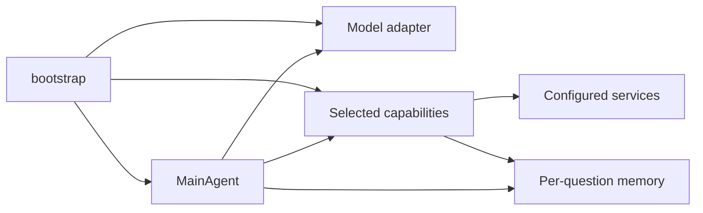

# Runtime contracts

`bootstrap.py` resolves one agent-system YAML, validates configuration and builds
one `MainAgent`, a model adapter, the selected flat capabilities and a memory
factory. There is no backend discovery during a question.

The agent owns turn ordering, one-call enforcement, stopping and reporting.
Capabilities own public input schemas, typed canonical output contracts, argument
translation, artifact registration and rendered evidence. Services execute work
without reading memory. Memory stores generic images, bindings and URL references;
it does not discover tools or interpret backend result fields.

Each call has a `VirtualCall` with the native call ID. Its `CapabilityResult`
contains success/error, canonical data, model-facing evidence and artifact refs.
Private trace fields preserve the concrete backend, raw envelope and grounding
sidecars. Canonical fields are always present: null means unavailable; an empty
list means a supported collection was evaluated and empty. Native arrays stay in
memory, with binding references in depth/camera canonical data.

## Memory and turn order

Each question begins with fresh memory. Input images receive `input_image_N`
handles; tool images receive `tool_generated_image_N`. Exact data-URL identity,
aliases, counter advancement and lazy image fetching preserve the old behavior.

A successful tool call registers images, typed bindings, then webpage references.
The capability renders evidence after registration. Chat Completions appends a
matching tool acknowledgement, user-role evidence and one coalesced Environment
Update. Responses appends a matching `function_call_output` containing the same
text/images, followed by the Environment Update. Failed payloads skip result
registration and do not emit a new inventory. A resolved lazy input image may
already exist before a later backend failure.

Depth arrays and camera matrices remain float32. SAM3 retains RLE masks and the
original `segment_<query>` dictionary. Local Python receives copied actual values;
the generation service receives only descriptors. Generated variables are not
persisted as new memory bindings. A local `execution_error` stays inside a
successful generation result, matching the baseline boundary.

Environment Update retains image/data/webpage section order and the exact
preamble. The default `always` policy may repeat unchanged inventory after a
successful call. `on_change` preserves the original change detector. The URL
limit shows the latest 20 entries without evicting older references.

## Native model behavior

Profiles explicitly select protocol, prompts, final-answer parsing and context
policy. Qwen uses the packaged `v8_instruct` prompt, Chat Completions and its own
tokenizer for the 168000-token context cap. If the tokenizer cannot load, a
warning records that the provider enforces context size. Luna uses `openai_v1`,
stateless Responses (`store=false`) and provider context enforcement.

The paper configurations use 15 iterations. Qwen retains its extra final-answer
request at exhaustion, empty-answer continuation and `<answer>` extraction;
Luna retains its assistant-text fallback and final-message behavior. Tool schemas
remain in the baseline router's alphabetical order. Neither path accepts a
multi-tool turn by silently executing only one call.

Native model/tool HTTP has a configured maximum of eight additional retries,
up to nine attempts, with 600-second timeouts. The old constructor's `retry: 3` did not control those
helpers; the new presets report the effective policy explicitly. Structured
router errors retain their call IDs and are returned once. Fatal HTTP400/401
are not retried. Search uses the OpenAI SDK's separate two-retry policy, with a
five-second connection timeout and 600-second remaining timeouts. Coding uses
the orchestrator backbone and native protocol, a fresh prompt, 4096 output tokens
and a separate 120-second request timeout. Its local executor has a 30-second
limit; generated Python is not sandboxed.

## Deployment and extension boundaries

Benchmark run manifests save the resolved profile for every configured model
service, including auxiliaries, and SHA256 hashes of its bundled system prompt
and the shared user prefix. The resume identity combines these with the agent
configuration, excluding credentials. Editing a referenced registry entry or
prompt content therefore rejects resume into the same run, even when the YAML
alias is unchanged. Unreferenced registry entries do not affect the identity.
Older manifests that hashed only the configuration are incompatible with this
check; start a new run directory rather than mixing new inference into those
saved results.

The router acquires per-backend capacity before entering the thread pool. Depth
and camera share one capacity group; queued GPU work does not block health
requests. Gates are process-local: deploy one router worker per configured raw
backend budget, or coordinate limits outside the process when scaling workers.
Endpoints, credentials and tuning fields cannot be supplied as model task args.

The paper registry contains nine public tools. The implemented extension is DINO
under the grounding capability. Other historical experimental backends are not
registered implicitly. New backends belong behind the corresponding capability;
new model profiles explicitly declare their protocol and supported options.

Two intentional semantic changes accompany extraction:

1. OCR stores the existing transcription as `ocr_result["text"]`, including a
   valid empty string, and advertises it to code generation.
2. DINO uses `segment_<query>` with `pred_boxes`/`pred_scores` and null masks/count.
   Its evidence describes bounding boxes and does not claim mask availability.

Reporting additionally retains partial trajectories on transport exceptions and
records Qwen usage totals. These reporting fields do not alter model inputs.

Additional boundary fixes found during extraction reject malformed grounding/page
records before artifact registration and credentials embedded in endpoint URLs.
Local coding capture is serialized because Python stdout redirection is process-
global; the old concurrent path could mix output from different questions. Main-
thread execution supports fractional timeout values and restores the previous
signal handler/timer. These are separately tested corrections for malformed input
and concurrent execution, outside the valid single-worker parity reference.

The inherited retry classifier has a known numeric-host edge case: it extracts
the first three-digit number in an exception message. An endpoint containing
127.0.0.1 can therefore be mistaken for a status code before the actual HTTP500,
so a generic provider error may not be retried. Both runtimes reproduce this
behavior; it is recorded for review rather than changed during parity validation.
